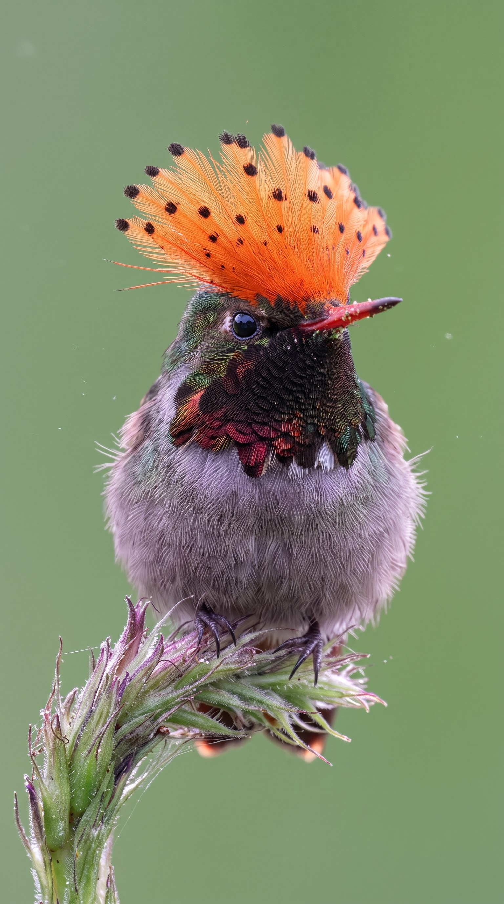
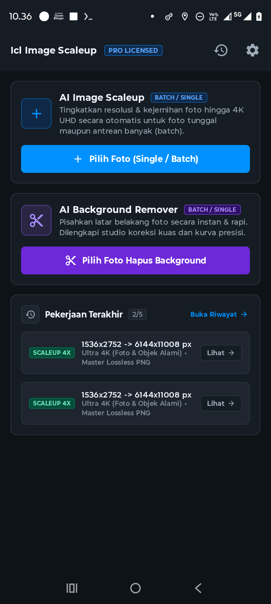
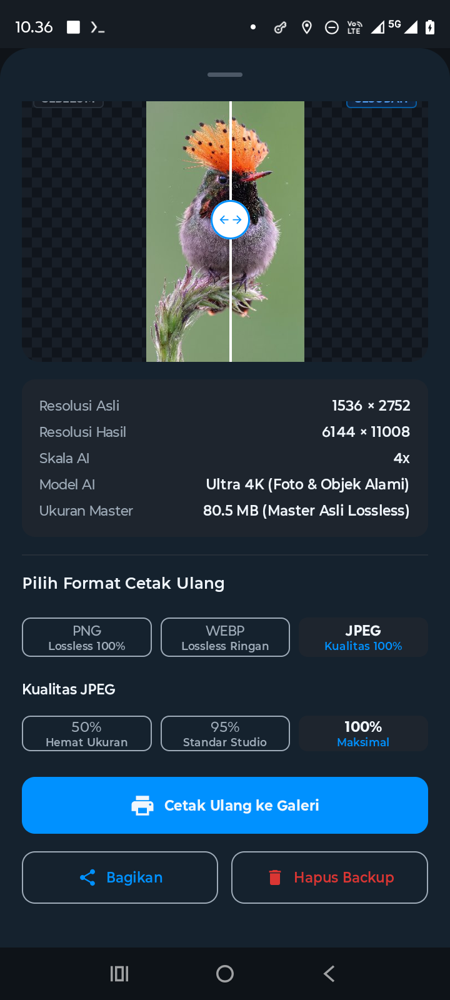
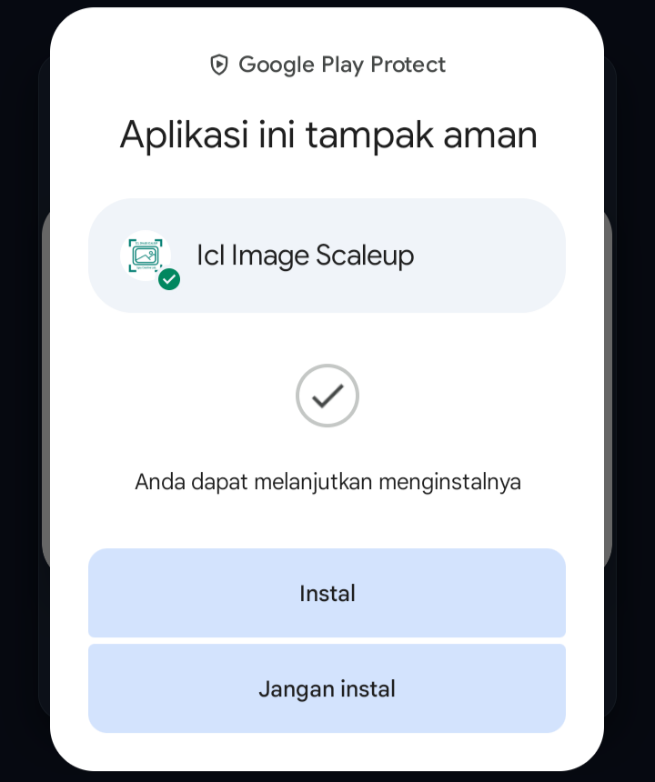

# 🚀 ICL Image Scaleup Studio — Official Release Distribution

Selamat datang di repositori distribusi resmi **ICL Image Scaleup Studio** oleh **Igoy Creative Lab**.  
Repositori ini khusus disediakan untuk pengunduhan berkas instalasi resmi (`.apk`) beserta panduan verifikasi keaslian aplikasi.

> **Unduh Aplikasi (v1.0.0, 58.93 MB):** [Download `app-release.apk`](https://github.com/ogibinedi/iclimagescaleup-app-release/raw/main/app-release.apk)

---

## ✨ Fitur Utama Studio (100% On-Device AI, Tanpa Cloud)

1. **AI Super-Resolution Upscaler (Hingga 4x / Resolusi 11K 67 MP)**
   - Mesin **ICL Proprietary AI Engine** dengan akselerasi perangkat keras & pemrosesan mulus bebas artefak kotak-kotak.
   - **Slider Perbandingan Sebelum/Sesudah dengan Pinch Zoom-In / Zoom-Out (`100%`–`1200%`)**: Cubit layar untuk memperbesar detail hasil scaleup vs gambar asli hingga resolusi pratinjau `4K (4096px)`, ketuk 2x untuk zoom cepat `300%`, geser area saat zoom, serta kontrol cepat (`−` / `%` / `+` / Reset) pada layar hasil & riwayat.
   - **Mode Potret Fotorealistik**: Restorasi tekstur pori kulit alami & ketajaman detail wajah tanpa efek lukisan lilin.
   - **Pre-Processing & Color Grading**: *Auto White-Balance*, *Denoise/Deblock*, kurva kecerahan/kontras/saturasi/warmth, serta kolase *Before/After* + *Zoom Loupe 2.5x*.
2. **AI Background Removal & Pas Foto Studio**
   - Pemisahan latar belakang otomatis berbasis AI dengan penghalus tepi helai rambut presisi tinggi.
   - **Alat Manual Presisi**: Kuas *Restore/Erase* dengan pengaturan *Feather*, *Pen Kurva Bézier* presisi, serta *Magic Eraser* (*Object Inpainting*).
   - **Kompositor Studio & E-Commerce**: Kanvas 1:1 Marketplace, 4:5 Feed, 9:16 Story, latar foto galeri + *Bokeh Blur*, *Contact/Drop Shadow*, *Floor Reflection*, dan *Die-Cut Sticker Outline*.
   - **Cetak Pas Foto Resmi (300 DPI)**: Latar Merah (`#DB1514`) & Biru (`#0054A6`), ukuran `2×3`, `3×4`, `4×6 cm`, serta penataan otomatis ke kertas **4R & A4 (JPG & PDF siap cetak)**.
3. **Ekspor Cerdas & Perlindungan Hak Cipta Fotografer**
   - **Pilihan Kualitas Kompresi JPEG (`50%`, `95%`, `100%`) & Pembatas Ukuran File**: Pilih kualitas kompresi JPEG di layar Utama, *Batch ScaleUp*, dan Riwayat (*Cetak Ulang*), atau aktifkan target ukuran otomatis `< 200 KB` (portal CPNS/SSCASN/BKN), `< 500 KB`, `< 1 MB`, atau `< 2 MB`.
   - **Optimasi Transparansi & Master Lossless**: Deteksi piksel alpha otomatis agar foto RGB tetap ringkas tanpa kanal transparansi berlebih.
   - **Watermark & Tanda Tangan EXIF Kustom (Lisensi Pro)**: Sematkan nama fotografer/studio dan hak cipta Anda langsung ke gambar serta metadata EXIF standar *Microstock* (*Adobe Stock / Shutterstock ready*).

---

## 📦 Informasi Berkas Rilis Resmi (`v1.0.0`)

> ⚠️ **PERINGATAN KEAMANAN**:  
> Hanya unduh dan instal **ICL Image Scaleup Studio** melalui tautan unduhan resmi atau halaman **Releases** pada repositori ini. Jangan pernah menginstal berkas APK dari grup chat atau tautan pihak ketiga yang tidak memiliki kecocokan nilai **SHA-256 Checksum** di bawah ini.

| Parameter | Nilai Resmi |
| :--- | :--- |
| **Nama Berkas** | `app-release.apk` |
| **Tautan Unduhan Resmi** | [Download `app-release.apk` (v1.0.0, 58.93 MB)](https://github.com/ogibinedi/iclimagescaleup-app-release/raw/main/app-release.apk) |
| **Paket Aplikasi** | `com.igoycreativelab.imagescaleup` |
| **Arsitektur Target** | `arm64-v8a` (Android 8.0 Oreo / API 26 ke atas) |
| **Ukuran Berkas Persis** | `61,796,062 bytes` (`58.93 MB`) |
| **SHA-256 Checksum APK** | `86901c3055ac8364e2b1904bcd161f300cc082b16ec9810f05c79cf168c84539` |
| **SHA-256 Sertifikat Pengembang** | `D8:EC:EE:19:71:33:19:BE:0E:3F:E2:42:BE:01:7A:77:12:B2:C2:B0:16:A1:9C:56:66:C2:CF:2A:8C:33:65:84` |

---

## 🛡️ Cara Memverifikasi Keaslian Aplikasi Anda

Anda dapat memastikan bahwa aplikasi yang terpasang di perangkat Anda adalah **100% asli rilisan Igoy Creative Lab** (bukan APK modifikasi/tiruan) melalui dua cara:

> **Portal Verifikasi Resmi:** [https://iclimagescaleup-release.netlify.app/](https://iclimagescaleup-release.netlify.app/)

### 1. Cek Kode Keaslian Aplikasi (Di Dalam Aplikasi)
1. Buka aplikasi **ICL Image Scaleup Studio** di HP Anda, lalu masuk ke menu **Pengaturan** (gulir ke bagian paling bawah: **Cek Keaslian Aplikasi**).
2. Ketik 4 angka acak pilihan Anda (contoh: `4829`).
3. Buka halaman **[Portal Verifikasi Resmi](https://iclimagescaleup-release.netlify.app/)** kami, lalu ketik 4 angka yang sama:
   - Contoh untuk kode uji `4829`, aplikasi asli akan selalu menampilkan: **`AUTH-JUZV-N45F`**.
4. Apabila kode respon yang muncul sama persis, maka aplikasi di HP Anda terjamin asli dan memiliki tanda tangan digital resmi **Igoy Creative Lab**.

### 2. Verifikasi Checksum SHA-256 Berkas APK
Gunakan fitur **Cek Keaslian File APK** pada halaman **[Portal Verifikasi Resmi](https://iclimagescaleup-release.netlify.app/)** (atau jalankan perintah `sha256sum app-release.apk` di terminal) dan pastikan hasilnya cocok 100% dengan tabel di atas.

---

## 🖼️ Daftar Gambar di Root Repositori (Sampel Hasil & Verifikasi)

Berikut adalah daftar berkas gambar yang tersedia di root direktori repositori ini beserta detail spesifikasi dan kegunaannya. Untuk membandingkan foto original dan hasil 4× AI scale-up secara interaktif (slider *Before/After* & zoom detail), Anda juga dapat mengunjungi **[Portal Verifikasi & Galeri Resmi](https://iclimagescaleup-release.netlify.app/)**.

| Berkas Gambar | Kategori | Resolusi & Format | Ukuran Berkas | Keterangan |
| :--- | :--- | :---: | :---: | :--- |
| [`sample_input.jpg`](./sample_input.jpg) | Foto Original (Input) | `1536 × 2752 px` (`4.23 MP`, JPEG) | `575.07 KB` (`588,867 bytes`) | Foto sampel asli sebelum diproses dengan AI Super-Resolution. |
| [`sample_output_1.png`](./sample_output_1.png) | Hasil 4× AI Scaleup (PNG) | `6144 × 11008 px` (`67.63 MP` / 11K, PNG 8-bit RGBA) | `80.51 MB` (`84,421,521 bytes`) | Hasil upscale **4×** (*Ultra 4K Foto & Objek Alami* — Master Lossless PNG) dengan metadata EXIF (`Model: Icl Image Scaleup`, `Artist`, `Copyright`). |
| [`sample_output_2.jpg`](./sample_output_2.jpg) | Hasil 4× AI Scaleup (JPEG) | `6144 × 11008 px` (`67.63 MP` / 11K, JPEG sRGB) | `28.49 MB` (`29,876,378 bytes`) | Hasil upscale **4×** (cetak ulang JPEG Kualitas 100%) dengan profil warna `sRGB` & metadata EXIF (`Model: Icl Image Scaleup`, `Artist`, `Copyright`). |
| [`main_ui_app.png`](./main_ui_app.png) | Tampilan Antarmuka | `720 × 1600 px` (PNG 8-bit RGBA) | `128.74 KB` (`131,833 bytes`) | Tangkapan layar beranda aplikasi **Icl Image Scaleup** (`PRO LICENSED`) — menampilkan AI Image Scaleup, AI Background Remover, dan riwayat pekerjaan. |
| [`ui_preview_app.png`](./ui_preview_app.png) | Tampilan Antarmuka | `720 × 1600 px` (PNG 8-bit RGBA) | `239.18 KB` (`244,918 bytes`) | Tangkapan layar pratinjau perbandingan *Before/After* di aplikasi beserta spesifikasi hasil (`1536 × 2752` → `6144 × 11008`, `80.5 MB` Master Lossless) dan opsi cetak ulang. |
| [`verified_google_protect.png`](./verified_google_protect.png) | Verifikasi Keamanan | `720 × 860 px` (PNG 8-bit RGBA) | `72.75 KB` (`74,494 bytes`) | Tangkapan layar **Google Play Protect** untuk **Icl Image Scaleup** (*"Aplikasi ini tampak aman — Anda dapat melanjutkan menginstalnya"*). |

> 💡 **Catatan Pratinjau:** Berkas hasil upscale beresolusi 11K (`6144 × 11008 px`) berukuran besar (`28.49 MB` dan `80.51 MB`), sehingga ditautkan langsung pada tabel di atas agar halaman README tetap ringan saat dibuka.

### 👀 Pratinjau Ringkas (`sample_input.jpg`, Tampilan UI & Verifikasi)

| Foto Original (`sample_input.jpg`) | Beranda Aplikasi (`main_ui_app.png`) | Pratinjau & Ekspor (`ui_preview_app.png`) | Google Play Protect (`verified_google_protect.png`) |
| :---: | :---: | :---: | :---: |
|  |  |  |  |

---

## 💎 Daftar Harga & Benefit Lisensi Pro (Sekali Bayar — Seumur Hidup)

Aplikasi **ICL Image Scaleup Studio** dapat diunduh dan diuji coba secara **Gratis (Mode Demo)** agar Anda dapat membuktikan langsung kualitas ketajaman hasil AI dan kecepatan pemrosesan di perangkat Anda sebelum membeli.

### 📊 Perbandingan Fitur: Mode Gratis (Demo) vs Lisensi Pro

| Fitur & Kemampuan Studio | Mode Gratis (Demo) | Lisensi Pro Permanen |
| :--- | :---: | :---: |
| **AI Super-Resolution Upscaler (2x & 4x hingga 11K / 67 MP)** | ✅ Penuh | ✅ **Penuh** |
| **Mode Potret Fotorealistik & Sintesis Tekstur Kulit Alami** | ✅ Penuh | ✅ **Penuh** |
| **AI Background Removal, Kuas Manual, Pen Bézier & Magic Eraser** | ✅ Penuh | ✅ **Penuh** |
| **Studio Pas Foto Resmi 300 DPI + Cetak Lembar 4R & A4 (JPG/PDF)** | ✅ Penuh | ✅ **Penuh** |
| **Ekspor Bersih 100% Tanpa Watermark Demo (Siap Cetak & Microstock)** | ❌ *(Watermark Demo)* | ✅ **Bebas Watermark Demo** |
| **Watermark Hak Cipta Studio Pribadi (Nama Bisnis / Fotografer Anda)** | ❌ | ✅ **Kustom Nama Studio Sendiri** |
| **2 Gaya Watermark Proteksi Karya (`Kisi Diagonal Penuh` & `Cap Sudut Kanan`)** | ❌ | ✅ **Bebas Pilih & Ganti Gaya** |
| **Sinkronisasi Watermark Real-Time pada Berkas Master & Draf di Menu Riwayat** | ❌ | ✅ **Tersedia** |
| **Penyematan Hak Cipta & Nama Fotografer Otomatis di Metadata EXIF** | ❌ *(Default Pengembang)* | ✅ **Atas Nama Anda / Studio Anda** |
| **Batch ScaleUp & Batch Background Studio Tanpa Watermark Demo** | ❌ | ✅ **Tak Terbatas (Unlimited)** |
| **Masa Aktif Lisensi** | Gratis Selamanya | ✅ **Seumur Hidup (Tanpa Langganan)** |

---

### 🏷️ Pilihan Paket Lisensi Resmi

Seluruh paket lisensi bersifat **One-Time Purchase (Sekali Bayar untuk Selamanya)** tanpa biaya langganan bulanan/tahunan dan berjalan **100% Offline** tanpa ketergantungan server:

| Paket Lisensi | Kuota Perangkat | Harga Promo Rilis | Harga Normal | Cocok Untuk |
| :--- | :---: | :---: | :---: | :--- |
| **🥉 Personal Pro** | **1 Perangkat** | **Rp 49.000** | ~~Rp 99.000~~ | Fotografer lepas, desainer grafis, *microstocker* (*Shutterstock / Adobe Stock*), kreator konten, & pengguna pribadi. |
| **🥈 Studio / UMKM Pack** *(Best Value)* | **Hingga 3 Perangkat** | **Rp 99.000** | ~~Rp 199.000~~ | Studio foto & pas foto, usaha cetak digital, admin *marketplace* / toko *online* (bisa diklaim bertahap atau 1 *Token Gabungan* untuk 3 HP). |
| **🥇 Enterprise / Agency Pack** | **Hingga 10 Perangkat** | **Rp 249.000** | ~~Rp 499.000~~ | Percetakan skala besar, agensi kreatif, tim produksi e-commerce, & operasional multi-cabang + prioritas dukungan teknis. |

> 💡 **Fleksibilitas Paket Multi-Device (Studio & Enterprise):**  
> - **Klaim Bertahap (Cicil Kuota):** Anda dapat mendaftarkan 1 perangkat terlebih dahulu saat membeli, lalu mendaftarkan sisa kuota perangkat Anda kapan saja di kemudian hari.  
> - **Klaim Sekaligus (1 Token Master Multi-Device):** Anda juga dapat mengirimkan seluruh **Kode Perangkat (`ICL-XXXX-XXXX`)** tim Anda sekaligus untuk mendapatkan **1 Kode Token Gabungan** yang sah dan aktif di seluruh perangkat terdaftar tersebut.

---

### 🔑 Cara Pembelian & Aktivasi Lisensi Pro (3 Langkah Mudah)

1. **Salin Kode Perangkat Anda:**  
   Buka aplikasi **ICL Image Scaleup Studio** &rarr; masuk ke menu **Pengaturan &rarr; Lisensi Perangkat**, lalu ketuk tombol salin pada **Kode Perangkat** Anda (format: `ICL-XXXX-XXXX`).
2. **Hubungi Admin Resmi Igoy Creative Lab:**  
   Kirimkan **Kode Perangkat** Anda beserta pilihan paket (**Personal 1 Device / Studio 3 Device / Enterprise 10 Device**) dan bukti pembayaran ke kontak resmi pengembang:
   - **Telegram Resmi:** [+6285162912471](https://t.me/+6285162912471)
3. **Tempel Kode Token Lisensi (100% Offline):**  
   Tempel (*paste*) **Kode Token Lisensi** (`ICL1....`) yang Anda terima ke kolom aktivasi di aplikasi, lalu ketuk **Aktifkan**. Status **Lisensi Pro Aktif** akan langsung terbuka secara permanen tanpa memerlukan koneksi internet!

---

© **Igoy Creative Lab**. Seluruh hak cipta dilindungi undang-undang.
